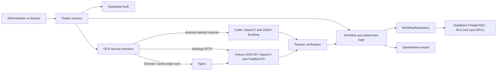
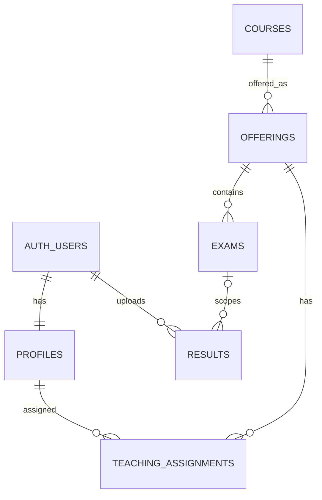

# OBE-Lens


**Handwritten marksheet capture, shared marking, and CO–PO attainment reporting.**

[](https://github.com/ullas-6575/CSE-3200/actions/workflows/ci.yml)


OBE-Lens helps teachers turn photographs of handwritten exam marks into reviewed, course-linked results. It connects course outcomes (COs), program outcomes (POs), exam question mappings, student marks, attainment calculations, and spreadsheet reports in one Flutter application.

Administrators manage registrations and course access. Assigned teachers configure exams, scan their question groups, verify OCR output, and calculate attainment. Students are identified by roll number in results; there is no student login role.

## Contents

- [Overview and objectives](#overview-and-objectives)
- [Features and marking rules](#features-and-marking-rules)
- [Technology stack](#technology-stack)
- [System architecture](#system-architecture)
- [Project structure](#project-structure)
- [Prerequisites](#prerequisites)
- [Installation and database setup](#installation-and-database-setup)
- [Run with local development tools](#run-with-local-development-tools)
- [Run on a PC with Docker](#run-on-a-pc-with-docker)
- [Configuration reference](#configuration-reference)
- [Database design](#database-design)
- [OCR HTTP API](#ocr-http-api)
- [Application usage](#application-usage)
- [Local preview](#local-preview)
- [Testing](#testing)
- [CI pipeline](#ci-pipeline)
- [Build and deployment](#build-and-deployment)
- [Security](#security)
- [Troubleshooting](#troubleshooting)
- [Known limitations and suggested improvements](#known-limitations-and-suggested-improvements)
- [Contributing and contributors](#contributing-and-contributors)
- [License and acknowledgements](#license-and-acknowledgements)

## Overview and objectives

The project addresses the manual work between recording exam marks and producing outcome-based education reports. OCR proposes values; the teacher remains responsible for reviewing and submitting the marks.

Its objectives are to:

- Capture a consistent marks rubric from camera or uploaded photographs.
- Keep marks linked to the correct course offering, exam, student, and question group.
- Let multiple assigned teachers contribute to the same student's result without silent overwrites.
- Apply explicit question-selection and attainment rules consistently.
- Produce inspectable student worksheets and CO–PO reports.

## Features and marking rules

### Accounts and course workflow

- Email/password signup, login, email-confirmation handling, and password recovery through Supabase Auth.
- Administrator approval or rejection of teacher registrations.
- Courses with CO1–CO4, descriptions, and selectable PO links.
- Academic-year/term offerings with multiple assigned teachers.
- Exam configuration: question parts, maximum marks, CO mappings, required groups, score thresholds, and attainment-level cutoffs.
- Course archiving and deletion checks that protect existing offering data.

### Capture and verification

- Question groups **Q1–Q4** and **Q5–Q8**, each with parts **a–g**: 28 cells per scan.
- Automatic corner detection, four-corner manual adjustment, 90-degree rotation, and perspective correction.
- Local Android recognition using ONNX Runtime; Python OCR for desktop and browser clients.
- Cell crop evidence, raw predictions, confidence flags, and optional manual corrections.
- English digits (`0–9`) only, one- or two-digit integer marks, preserved leading zeroes, and `N/A` for blank or unrecognized cells. The model suppresses non-digit output classes and retains its original digit confidence scores.
- **Inference only:** no training, fine-tuning, dataset collection, or automatic model-weight downloads.

### Shared marking and question choice

The database stores one group result per **exam + roll number + question group**. The results worksheet combines both groups into one student row.

| Situation within a four-question group             | Current behavior                                                                             |
| -------------------------------------------------- | -------------------------------------------------------------------------------------------- |
| Exactly three questions answered                   | Count those three automatically; no selection prompt.                                        |
| All four answered                                  | Require the teacher to choose exactly three; do not automatically choose the highest scores. |
| Fewer than three answered                          | Count the answers present and award zero for missing answer slots.                           |
| Existing group uploaded again                      | Ask **Replace marks** or **Keep previous**.                                                  |
| Another teacher changes a group during replacement | Reject the stale confirmation and ask again using the latest revision.                       |

A question is answered if any part has a numeric mark, including `0`; a question containing only `N/A` is unanswered. All raw marks remain stored, including marks in an uncounted fourth question. Replacing one group preserves the other group.

The overall maximum covers three question slots per four-question group. If question maxima differ, missing slots use the largest remaining question maxima. Groups configured with fewer than four questions count their configured questions. See [question-selection logic](lib/workflow/models.dart) and [regression tests](test/question_choice_test.dart).

### Totals, GPA, attainment, and exports

- Merged student totals and percentages use counted questions. GPA remains pending until all required groups and any necessary question choices are available.
- The GPA function implements the repository's Bangladesh UGC-style 4.0 scale: 80% → 4.00, 75% → 3.75, 70% → 3.50, 65% → 3.25, 60% → 3.00, 55% → 2.75, 50% → 2.50, 45% → 2.25, 40% → 2.00; below 40% → 0.00.
- For each student and assessed CO, sum earned marks and maxima from counted question parts. Achievement is `1` when `earned / maximum × 100` meets the exam's score threshold, otherwise `0`. The default threshold is 50%.
- **CO attainment %** = students achieving the CO ÷ eligible students assessed on that CO × 100.
- **PO contribution %** = the equal mean of attainment percentages of linked, assessed COs. CO–PO links are unweighted.
- Incomplete required groups are excluded from attainment. Invalid marks or unresolved four-answer choices block report export. Unassessed COs remain `N/A`, rather than becoming an artificial zero. Missing answer slots affect the overall grade; the calculator does not invent CO mappings for unanswered optional questions.
- Default attainment bands are L0 ≤55%, L1 >55–65%, L2 >65–75%, L3 >75–85%, and L4 >85%. The exam can configure these cutoffs.
- Result and attainment exports are **SpreadsheetML XML files with an `.xls` extension**, not `.xlsx`, PDF, or CSV. Attainment workbooks separate report details, student CO achievement, CO attainment, and PO contributions. Export rechecks report freshness.

The calculation code is in [attainment.dart](lib/workflow/attainment.dart), [models.dart](lib/workflow/models.dart), and [grading.dart](lib/workflow/grading.dart).

## Technology stack

Versions below come from repository configuration and lockfiles; they are not claims of successful builds on every platform.

| Layer                   | Technology and configured version                                                 | Purpose                                                       |
| ----------------------- | --------------------------------------------------------------------------------- | ------------------------------------------------------------- |
| Client                  | Flutter 3.24.0 in Docker/CI; Dart `>=3.5.0 <4.0.0`                                | Material UI and shared application logic                      |
| Authentication/data     | `supabase_flutter` 2.15.4                                                         | Auth sessions, PostgREST queries, and save RPCs               |
| Database                | Supabase PostgreSQL; local config targets PostgreSQL 17                           | Academic entities, validation, access policies, and revisions |
| Client packages         | `image_picker` 1.1.2, `http` 1.6.0, `google_fonts` 6.3.0                          | Image input, OCR transport, and typography                    |
| File export             | `share_plus` 10.1.4, `file_selector_platform_interface` 2.6.2, `web` 1.1.1        | Save/share spreadsheet files                                  |
| Android                 | Kotlin 1.9.24, Android Gradle Plugin 8.1.1, Gradle 8.3                            | Native detector and recognizer integration                    |
| Android inference       | ONNX Runtime 1.21.1, OpenCV 4.12.0, ExifInterface 1.3.7                           | On-device cell recognition and image geometry                 |
| OCR service             | Python 3.11 Docker base, PaddleOCR 3.7.0, PaddlePaddle 3.3.1, ONNX Runtime 1.30.0 | CPU inference with the shared fine-tuned recognition model    |
| Python image processing | OpenCV contrib 4.12.0.88, NumPy `>=2,<2.3`, Pillow `>=13,<14`                     | Detection, cropping, and image decoding                       |
| Browser delivery        | Nginx `stable-alpine`, Docker Compose                                             | Flutter web files and same-origin OCR proxy                   |
| Verification            | Flutter Test, Python `unittest`, SQL assertions, JUnit 4.13.2                     | UI/domain, API, database, and detector-parity tests           |

Sources: [pubspec.yaml](pubspec.yaml), [pubspec.lock](pubspec.lock), [Python requirements](obelens-ocr/requirements.txt), [Android configuration](android/app/build.gradle), and [CI](.github/workflows/ci.yml).

## System architecture



- **Presentation:** Flutter screens/widgets and an authenticated navigator. Sign-out or session loss removes protected navigation.
- **Domain:** Dart models, mark validation, question selection, GPA, and attainment calculations. The attainment calculator has no Flutter, database, or recognizer dependency.
- **Adapters:** `WorkflowRepository`, `AuthService`, OCR services, and the report exporter separate screens from external systems. Tests inject fakes; local preview uses in-memory implementations.
- **Persistence:** PostgreSQL validates full group saves and handles duplicate/replacement decisions atomically. Direct updates to result rows remain revoked; the controlled save path checks approval, offering access, and revisions.
- **OCR:** Detection and recognition are separate operations. The HTTP API returns a proposed grid and crop evidence; it does not authenticate teachers or save academic results. Flutter performs the subsequent authenticated database save.

## Project structure

```text
.
├── lib/
│   ├── main.dart, bootstrap.dart, app.dart  # Startup and service composition
│   ├── models/                            # OCR grids, crop selections, scan contracts
│   ├── screens/                           # Auth, capture, crop, verification, results
│   ├── services/                          # Auth, OCR clients, standalone results, preview
│   ├── workflow/                          # Courses, exams, shared saves, grading, reports
│   ├── theme/                             # Application theme
│   └── widgets/                           # Marks tables, worksheets, crop controls
├── android/                               # Kotlin/OpenCV/ONNX runner
│   └── detector-tests/                     # Kotlin/Python detection parity runner
├── linux/, windows/, web/                  # Other included Flutter platform targets
├── assets/
│   ├── branding/                          # Master app icon
│   ├── ocr_model/                         # Shared fine-tuned ONNX model, config and dictionary
│   ├── fonts/                             # FreeSans and its license notices
├── obelens-ocr/
│   ├── ocr/                               # Detection, extraction, inference, HTTP API
│   ├── models/recognition/                 # obelens model copy for the Python service
│   ├── scripts/                           # Single-image checks and detection fixtures
│   ├── tests/                             # Python unit/API tests
│   └── requirements.txt
├── supabase/
│   ├── migrations/                        # Ordered schema and behavior changes
│   ├── tests/                             # Local Auth stub, SQL and concurrency tests
│   ├── promote_admin.sql                  # First-admin setup helper
│   └── config.toml                        # Local Supabase configuration
├── scripts/                               # Desktop link setup and database test runner
├── docker/                                # Nginx config and smoke-test utilities
├── test/                                  # Flutter unit/widget/integration tests
├── docs/WORKFLOW.md                        # Additional workflow/extension notes
├── .github/workflows/ci.yml                # Test and native-build pipeline
├── Dockerfile, compose.yaml, .dockerignore
├── pubspec.yaml, pubspec.lock
└── REQUIREMENTS.txt                        # Additional local setup notes
```

The checked-in targets are Android, Linux, Windows, and web. Native iOS/macOS project directories are not included. Local datasets, training directories, and fine-tuning tooling are not part of this project.

## Prerequisites

Choose a route before installing tools:

| Route                  | Requirements                                                                                                                     |
| ---------------------- | -------------------------------------------------------------------------------------------------------------------------------- |
| Docker browser app     | Git; Docker Engine/Desktop with Compose; configured Supabase project                                                             |
| Android app            | Flutter 3.24.0-compatible SDK; JDK 17; Android SDK 35; device/emulator at API 24 or later; configured Supabase project           |
| Linux/Windows app      | Flutter SDK and the platform's desktop C++ toolchain; Python OCR service locally or over HTTP(S); configured Supabase project    |
| Python OCR development | Python 3.11, a virtual environment, packages from `obelens-ocr/requirements.txt`, and compatible model files                     |
| Database tests         | Unix-like environment, Bash, Python 3, and PostgreSQL tools: `pg_config`, `initdb`, `pg_ctl`, and `psql`; run as a non-root user |

Run `flutter doctor -v` for native toolchain diagnostics. The Linux CI installs:

```bash
sudo apt-get update
sudo apt-get install --yes clang cmake ninja-build pkg-config libgtk-3-dev
```

Docker images target **linux/amd64**. ARM/Apple Silicon hosts need compatible emulation; that path is not verified here. Plan for several GB of image/toolchain storage and memory. Authentication and database operations require access to your Supabase project, even when Android OCR runs locally.

## Installation and database setup

### 1. Clone the repository

```bash
git clone https://github.com/ullas-6575/CSE-3200.git
cd CSE-3200
```

### 2. Configure Supabase

1. Create or select a Supabase project you control. Obtain its project URL and client publishable key. Do not use a service-role/secret key in Flutter.
2. Apply **all** files in [supabase/migrations](supabase/migrations) in filename order, starting with `20261013200000_create_results.sql`. For a new project, execute them in the Supabase SQL Editor in that order; for an existing project, apply only unapplied migrations. Do not blindly rerun the initial schema.
3. In particular, include both recent behavior migrations:
   - [Confirmed group replacement](supabase/migrations/20261127185331_confirm_question_group_replacement.sql).
   - [Automatic counting and three-question choice](supabase/migrations/20261127190719_teacher_selected_three_questions.sql).
4. Create the first administrator account through signup or Supabase Auth. In a **trusted SQL Editor session**, adapt the email in [promote_admin.sql](supabase/promote_admin.sql) and execute it. Sign out and back in to refresh the account's trusted app metadata.
5. Configure Auth email delivery/confirmation and the redirect allowlist. Include `com.obelens.app://auth-callback/` for native password recovery and the actual web origin/return URL for browser recovery. The local `config.toml` example URLs do not configure your hosted project.
6. After signing in as administrator, approve teachers through **Registrations** and assign them to offerings.

Earlier migrations restrict mappings to CO1–CO4; existing mappings outside that range must be corrected before those migrations can run. The Docker stack does **not** start Supabase or apply migrations. Hosted schema state, email delivery, and administrator provisioning must be verified separately.

### 3. Shared fine-tuned inference model

| Client path                | Model inputs                                                                                                                             |
| -------------------------- | ---------------------------------------------------------------------------------------------------------------------------------------- |
| Android                    | `assets/ocr_model/obelens.onnx` and `assets/ocr_model/ppocrv5_en_dict.txt`, included by `pubspec.yaml`                                   |
| Python API for desktop/web | Identical ONNX weights at `obelens-ocr/models/recognition/inference.onnx`, with `inference.yml` for PaddleOCR preprocessing and decoding |

The default model on every platform is named `obelens`, supplied in `obelens_stage2_best_accuracy/` and fine-tuned from `en_PP-OCRv5_mobile_rec`. Its trained weights are preserved, with an output mask allowing only English digits (`0–9`) and the CTC blank. The restricted ONNX model replaces the bundled model in `assets/ocr_model/`; the full dictionary remains to preserve class indices. The Python service retains its original `models/recognition/` directory with an identical copy. It explicitly uses PaddleOCR's `onnxruntime` engine, so it requires no `inference.json` or Paddle parameter files. Use `--model-dir` only to select another compatible directory containing `inference.onnx` and `inference.yml`. See [model provenance](assets/ocr_model/README.md).

For Android, replace the bundled compatible ONNX model/dictionary or select another bundled model through `OCR_MODEL_ASSET`. The current adapter builds a `[1, 3, 48, 320]` input tensor and expects CTC-style output matching the dictionary. A different model format needs an adapter change, not just a filename change. Include any alternate asset in `pubspec.yaml`.

No setup command downloads replacement OCR weights. Model initialization is lazy, so a healthy API can still fail its first recognition request if files are missing or incompatible.

## Run with local development tools

The following shell examples use Bash. On Windows, activate the environment with `.venv\Scripts\Activate.ps1` in PowerShell instead of `source`.

### Install dependencies

```bash
flutter pub get
python3.11 -m venv .venv
source .venv/bin/activate
python -m pip install -r obelens-ocr/requirements.txt
```

Android on-device OCR does not require the Python environment; install it when developing the desktop/web OCR service or running Python/parity tests.

### Start the OCR service — terminal 1

Start the service with the bundled fine-tuned model:

```bash
source .venv/bin/activate
cd obelens-ocr
python -m ocr.server --host 127.0.0.1 --port 8765
```

### Start the Flutter app — terminal 2

From the repository root, replace the safe configuration placeholders:

```bash
flutter run -d linux \
  --dart-define=SUPABASE_URL=https://YOUR-PROJECT.supabase.co \
  --dart-define=SUPABASE_PUBLISHABLE_KEY=YOUR_PUBLISHABLE_KEY
```

Use `-d windows` on a Windows development machine, or `flutter run` with an attached Android device/emulator. Android chooses local ONNX OCR automatically; setting `OCR_API_URL` does not switch the default Android recognizer to the Python service.

For Linux/Windows using a remote OCR API, also pass `--dart-define=OCR_API_URL=https://your-ocr-host.example`. The native Python client defaults to `http://127.0.0.1:8765`; its Android HTTP fallback defaults to `http://10.0.2.2:8765` when that client is explicitly used.

**Browser OCR needs the same-origin proxy.** The Python API has no CORS/preflight implementation, so pointing a separate `flutter run -d chrome` origin directly at it is not a complete setup. Use the Docker browser route below or serve a Flutter web build behind a proxy equivalent to [docker/nginx.conf](docker/nginx.conf).

## Run on a PC with Docker

### Standard browser stack

Configure the Supabase schema first; the fine-tuned OCR model is included:

```bash
docker compose up --build -d
docker compose ps
curl http://localhost:8080/health
```

Open **http://localhost:8080**. Nginx serves Flutter web and forwards `/ocr/` and `/health` to the OCR container. Only the web port is published, bound to loopback by default. The OCR service mounts `obelens-ocr/models/recognition/` read-only; the standalone OCR image also includes this model.

The first build downloads Flutter and Python dependencies, **not model weights**. The health endpoint confirms the API is listening; it does not load or validate the recognition model.

```bash
docker compose logs -f
docker compose logs -f ocr
docker compose down
```

To use another port, create a root `.env` containing:

```dotenv
OBELENS_PORT=8081
```

Then recreate the services and use `http://localhost:8081`. Rebuild after source changes; restart the OCR service after replacing model files:

```bash
docker compose up --build -d
docker compose restart ocr
```

**Configuration boundary:** the stock Dockerfile compiles the web app with the defaults in `lib/main.dart`. It does not forward Supabase/OCR Dart defines from Compose or the host environment. Compose's `.env` currently substitutes `OBELENS_PORT` only; it does not inject `OBELENS_OCR_TOKEN` into the container. Do not assume setting these names in `.env` changes the compiled client or server.

### Browser build with your own Supabase settings

With Flutter installed on the host, build a configured web bundle and mount it over the standard container's files:

```bash
flutter build web --release \
  --dart-define=SUPABASE_URL=https://YOUR-PROJECT.supabase.co \
  --dart-define=SUPABASE_PUBLISHABLE_KEY=YOUR_PUBLISHABLE_KEY

docker compose up --build -d ocr
docker compose stop web
docker compose run --rm --build --service-ports \
  --volume "$PWD/build/web:/usr/share/nginx/html:ro" web
```

This runs the web container in the foreground with the existing same-origin OCR proxy. Stop it with Ctrl+C. For repeatable hosted deployment, package the configured build in your own image rather than relying on this development bind mount.

### OCR API image only

```bash
docker build --platform linux/amd64 --target ocr -t obelens-ocr .
docker run --rm --init --platform linux/amd64 \
  -p 127.0.0.1:8765:8765 \
  obelens-ocr
```

To enable optional OCR bearer checking for this container, supply `-e OBELENS_OCR_TOKEN=YOUR_OCR_TOKEN` and compile the matching `OCR_API_TOKEN` into the client. Treat the static client token as an endpoint gate, not as a substitute for individual Supabase authorization.

## Configuration reference

**Dart defines are compile-time configuration.** Pass them to `flutter run` or `flutter build`; ordinary shell exports and `.env` files are not automatically read by the app. The existing source has Supabase defaults, but another installation should pass its own values explicitly.

| Name                                    | Scope                                | Purpose/default                                                                                   | Required                                  |
| --------------------------------------- | ------------------------------------ | ------------------------------------------------------------------------------------------------- | ----------------------------------------- |
| `SUPABASE_URL`                          | Dart define                          | Supabase project URL; example `https://YOUR-PROJECT.supabase.co`                                  | For a different project's live workflow   |
| `SUPABASE_PUBLISHABLE_KEY`              | Dart define                          | Client publishable key; example `YOUR_PUBLISHABLE_KEY`                                            | With a custom project URL                 |
| `OBELENS_LOCAL_PREVIEW`                 | Dart define                          | `false`; `true` uses in-memory Auth/workflow data                                                 | Optional                                  |
| `OCR_API_URL`                           | Dart define                          | Same web origin, desktop `http://127.0.0.1:8765`, or Android HTTP fallback `http://10.0.2.2:8765` | For a non-default HTTP endpoint           |
| `OCR_API_TOKEN`                         | Dart define                          | Unset; sent as a bearer token by the Python OCR client                                            | If the server enables token checking      |
| `OCR_MODEL_ASSET`                       | Dart define                          | Android default `assets/ocr_model/obelens.onnx`                                                   | For an alternate bundled compatible model |
| `OBELENS_PORT`                          | Compose substitution                 | `8080`, published on `127.0.0.1`                                                                  | Optional                                  |
| `OBELENS_OCR_TOKEN`                     | Python process/container environment | Unset; enables bearer validation on OCR POST requests                                             | Optional for local use                    |
| `PADDLE_PDX_CACHE_HOME`                 | Python process environment           | Local server: `obelens-ocr/.cache/paddlex`; Docker: `/app/.cache/paddlex`                         | Optional override                         |
| `PADDLE_PDX_DISABLE_MODEL_SOURCE_CHECK` | Python process environment           | Adapter defaults to `True` before loading PaddleOCR                                               | Normally leave at the default             |
| `XDG_DATA_HOME`                         | Linux registration script            | Defaults to `~/.local/share`; controls desktop-entry destination                                  | Optional                                  |

Server arguments: `--host` (default `127.0.0.1`), `--port` (`8765`), `--model-dir` (local recognition directory), and `--confidence-threshold` (`0.8`). Container-build arguments `FLUTTER_VERSION` and `FLUTTER_SHA256` belong to the Docker toolchain download; they are not application settings.

## Database design



| Entity                 | Important data and relationships                                                                                                                 |
| ---------------------- | ------------------------------------------------------------------------------------------------------------------------------------------------ |
| `auth.users`           | Supabase-managed identities; trusted administrator role in app metadata                                                                          |
| `profiles`             | User-linked name/email and registration status: pending, approved, rejected; legacy approval compatibility                                       |
| `courses`              | Course code/title, CO definitions and PO links in JSON, archive state, revision                                                                  |
| `offerings`            | Course, academic year, term; unique per course/year/term                                                                                         |
| `teaching_assignments` | Offering/teacher pairs; supports multiple teachers per offering                                                                                  |
| `exams`                | Offering, name, question-part mappings, required groups, attainment policy, revision                                                             |
| `results`              | Teacher/submission IDs, roll number, group, raw marks JSON, counted-question array, counted total, timestamps, revision, optional exam reference |

Each course-scoped result is unique on `(exam_id, roll_no, table_type)`. A student is represented by matching roll-number records within an exam, not by a separate student table. Old unassigned results have `exam_id = null` and stay separate from course attainment.

The current app saves through `save_question_group`: it validates access, resolves automatic/manual question choices, serializes matching uploads, and compares revisions before replacement. The older insert-only `save_verified_marks` remains for compatibility. RLS protects reads and ordinary inserts; the private save function explicitly checks authorization before its controlled updates. See [migrations](supabase/migrations) and [shared-save tests](supabase/tests/shared_marks.sql).

## OCR HTTP API

The Python service defaults to port **8765**. Under Compose, use the same paths through port **8080** (or `OBELENS_PORT`). These are OCR endpoints, not the Supabase database API.

| Method | Endpoint      | Purpose                                                         | Authentication               |
| ------ | ------------- | --------------------------------------------------------------- | ---------------------------- |
| `GET`  | `/health`     | HTTP-service status and configured model name; no model warm-up | None                         |
| `POST` | `/ocr/detect` | Suggest normalized table corners without recognition            | Optional static bearer token |
| `POST` | `/ocr/table`  | Extract and recognize 28 cells for a question group             | Optional static bearer token |

### Request fields

| Field                | Applies to          | Meaning                                                                                                     |
| -------------------- | ------------------- | ----------------------------------------------------------------------------------------------------------- |
| `image_base64`       | Both POST endpoints | Required Base64-encoded image bytes                                                                         |
| `rotation`           | Both                | Optional `0`, `90`, `180`, or `270`; applied after EXIF orientation                                         |
| `table_type`         | `/ocr/table`        | `1-4` by default, or `5-8`                                                                                  |
| `normalized_corners` | `/ocr/table`        | Optional four `[x,y]` points in `[0,1]`, ordered top-left, top-right, bottom-right, bottom-left             |
| `corners`            | `/ocr/table`        | Alternative four pixel-coordinate corners; do not combine with normalized corners                           |
| `max_mark`           | `/ocr/table`        | Optional common validation maximum; the current Flutter HTTP client does not send exam-specific cell maxima |

Without explicit corners, table recognition attempts automatic extraction. Database/application validation later checks the exam's individual question-part maxima.

Example table request structure; the Base64 value and coordinates are illustrative:

```json
{
  "image_base64": "BASE64_IMAGE_BYTES",
  "table_type": "5-8",
  "rotation": 0,
  "normalized_corners": [
    [0.1, 0.1],
    [0.9, 0.1],
    [0.9, 0.9],
    [0.1, 0.9]
  ]
}
```

Detection returns `detected`, `normalized_corners` or `null`, `rotation`, `width`, and `height`. A valid image with no detectable table returns HTTP 200 with `detected: false`, allowing manual selection.

Recognition returns `tableType`, `questions`, `cellMarks`, `cellResults`, `confidenceScore`, `needsReview`, `isVerified: false`, `scannedAt`, `tableCorners`, and `rotation`. Cell details include raw text, parsed value, confidence, review reason, bounds, and PNG crop evidence as Base64. A successful response contains all 28 cells; the teacher still reviews the result.

Send your own table photograph through the Compose proxy from the repository root:

```bash
python3 - <<'PY' > /tmp/obe-ocr-request.json
import base64
import json
from pathlib import Path
print(json.dumps({
    "image_base64": base64.b64encode(
        Path("path/to/your-table.png").read_bytes()).decode("ascii"),
    "table_type": "1-4"
}))
PY
curl --fail-with-body \
  -H 'Content-Type: application/json' \
  --data-binary @/tmp/obe-ocr-request.json \
  http://localhost:8080/ocr/table
```

Add `Authorization: Bearer YOUR_OCR_TOKEN` if configured. Use `/ocr/detect` with the same image field to test corner detection.

Limits: Flutter accepts images up to **10 MiB**; the API caps request JSON at **16 MiB** and decoded images at **25 megapixels**. POST requests need `Content-Length`, which the example generates automatically. Typical errors are 401 for token rejection, 413 for empty/oversized bodies, 422 for invalid images/geometry/fields, 500 for recognition/model failures, and 404 for unknown paths. The supplied service is intended for local/development use; it has no built-in TLS, browser CORS support, or user-account authentication.

## Application usage

1. **Administrator:** sign in, review **Registrations**, approve teachers, and open **Manage courses**. Set CO descriptions/PO links, add year/term offerings, and assign approved teachers.
2. **Teacher:** open **Assigned courses**, select an offering, and create or configure an exam. Map the active parts of Q1–Q8 to CO1–CO4 and set maxima, required groups, and attainment thresholds.
3. Open **Scan**, enter the student's roll number, and select the question group. Camera/gallery input opens **Adjust Table**; check corners and rotation, then continue.
4. Review the extracted marks and any flags, then select **Verify & Submit**. Marks save automatically unless all four questions have answers; in that case, choose three on the submission summary and save. A duplicate group requires a replacement decision; a failed save retains the reviewed work for retry.
5. After saving a part, a popup offers **Done** or **Scan other part** when another required part remains. **Done** returns to the exam page, where **Scan** asks for the next student's roll number. **Scan other part** opens the remaining group for the same student. After both parts are saved, the popup offers **Done** only. Different groups fill the same student worksheet row.
6. Open **All results** to inspect the combined student row, counted questions, totals, percentage, and GPA. Four-answer results can reopen **Choose counted questions** with replacement confirmation.
7. Open **Calculate attainment** for the student CO worksheet and CO/PO contributions. Review completeness/mapping issues before **Export to Excel**. Linux/Windows use Save As; other targets use the platform/browser share mechanism.

## Local preview

To inspect the workflow without configuring Supabase:

```bash
flutter run -d linux --dart-define=OBELENS_LOCAL_PREVIEW=true
```

Use `-d chrome` for browser UI preview. This mode supplies in-memory accounts/course data and resets on restart. It still uses the normal OCR service if you scan; it is not an offline OCR mock.

The repository includes the [app icon](assets/branding/obe_lens_icon.png). Upload your own table photograph to scan. Automated checks generate synthetic table images; no handwritten sample sheet is bundled.

## Testing

Run from the repository root unless stated otherwise:

| Check                    | Command                                                                 | Requirements/coverage                                                                                                                                                            |
| ------------------------ | ----------------------------------------------------------------------- | -------------------------------------------------------------------------------------------------------------------------------------------------------------------------------- |
| Dart analysis            | `flutter analyze`                                                       | Static checks and configured lints                                                                                                                                               |
| Flutter suite            | `flutter test`                                                          | Auth/navigation, crop/review, marking rules, shared saves, GPA, reports, and exports; external services are generally replaced by fakes                                          |
| Local database suite     | `bash scripts/test_workflow_db.sh`                                      | PostgreSQL tools, Bash, Python 3; applies every migration in a disposable cluster and checks RLS, validation, idempotency, selections, stale replacements, and parallel teachers |
| Desktop-link setup tests | `python3 -m unittest discover -s scripts -p 'test_desktop_links.py' -v` | Uses temporary paths and mocked OS registration                                                                                                                                  |
| Compose smoke test       | `python3 docker/smoke_test.py path/to/your-table.png`                   | Running Compose stack and supplied model; checks UI, proxy, detection, and real OCR                                                                                              |

Python unit/API tests, with the environment active:

```bash
cd obelens-ocr
python -m unittest discover -s tests -v
```

The API tests bind temporary localhost sockets. The database test runner uses a private temporary Unix socket, stops its PostgreSQL cluster on exit, and never connects to the hosted project. `supabase/tests/auth_stub.sql` is for that disposable database only; do not apply it to Supabase.

Optional real-model integration test:

```bash
flutter test test/ocr_service_test.dart --dart-define=OCR_INTEGRATION=true
```

It is skipped by default and expects the Unix-style `.venv/bin/python` path at the repository root plus the bundled fine-tuned model; the harness does not resolve a native Windows virtual-environment path. It starts a temporary Python API and checks the Dart-to-Python scan path.

Optional Android/Python detector parity check:

```bash
android/gradlew -p android/detector-tests test
```

The wrapper files are Git-ignored; if missing, let a Flutter Android build generate them first, for example `flutter build apk --debug`. The parity runner also needs the root Python environment; use `-Ppython=/absolute/path/to/python` to override it. See [runner instructions](android/detector-tests/README.md). These checks do not replace device-camera, mobile OCR, hosted Auth email, and platform share/save testing.

This documentation update does not assert a fresh run of every test, native build, container build, or hosted service check. Use the commands above and the relevant CI run for your checkout.

## CI pipeline

[.github/workflows/ci.yml](.github/workflows/ci.yml) runs on pull requests targeting `main`, pushes to `main`, and manual dispatch.

1. **Test job:** install dependencies with Flutter 3.24.0, run analysis and Flutter tests, install PostgreSQL, then run the disposable database suite.
2. **Build job, after tests:** build release APK, Linux bundle, and Windows release folder in a platform matrix. Android uses JDK 17; Linux installs GTK/C++ build dependencies.
3. **Artifact upload:** store outputs named with platform and commit SHA. The Linux bundle is archived to preserve executable permissions.

CI currently does not run the Python OCR suite, optional real-model integration, detector parity, Docker builds/smoke tests, or hosted Supabase advisors. It does not apply hosted migrations, publish app-store releases, or deploy a public website. The configured pipeline is CI with downloadable build artifacts, not automated production deployment.

## Build and deployment

Include the same `--dart-define` settings used during development in release builds; they are embedded at build time.

| Target              | Command                           | Output                                          |
| ------------------- | --------------------------------- | ----------------------------------------------- |
| Android             | `flutter build apk --release`     | `build/app/outputs/flutter-apk/app-release.apk` |
| Linux               | `flutter build linux --release`   | `build/linux/x64/release/bundle/`               |
| Windows, on Windows | `flutter build windows --release` | `build/windows/x64/runner/Release/`             |
| Web                 | `flutter build web --release`     | `build/web/`                                    |

Distribute the complete Linux bundle or Windows release directory, including its `data/` and library files. The executable alone is insufficient. Desktop OCR also needs the Python API; it is not bundled into the native executable.

Register a final installed desktop executable for password-reset links:

```bash
python3 scripts/register_desktop_links.py /absolute/path/to/obelens
```

On Windows, use `py scripts/register_desktop_links.py "C:\path\to\obelens.exe"`. The script registers the current user's handler and, on Linux, the bundled app icon. Linux registration also requires `xdg-mime` from `xdg-utils`. Rerun it if you move the bundle. Test recovery links with the app both closed and already running.

Before public deployment:

- Configure intended Supabase settings, all migrations, administrator access, and real Auth redirect URLs.
- Configure release signing: Android's current release build uses the **debug signing configuration**, and its application ID remains `com.example.my_app`.
- Serve web files with an appropriate same-origin OCR reverse proxy and HTTPS. The supplied local Compose binding and Python development server are not a complete public hosting setup.
- Confirm the model format/dictionary, hosted access policies, file exports, and device behavior. No production deployment URL or store release is verified by this repository.

## Security

- Supabase Auth owns login and recovery. Administrator authorization uses trusted `app_metadata`, not user-editable metadata.
- New teacher profiles await approval. Database access is limited to administrators or approved teachers assigned to the relevant offering; unassigned legacy results remain owner-scoped.
- RLS remains enabled. Direct result updates are revoked; the private save operation checks identity, approval, offering access, complete grid shape, marks, maxima, archive state, and revisions.
- Submission UUIDs support safe retries; group uniqueness and transaction locks protect simultaneous uploads. The server computes counted totals instead of trusting client totals.
- Uploaded sheets/crops are processed in memory by the HTTP API. Optional image-check scripts explicitly write local output files; those files are ignored.
- The OCR API's optional bearer token is separate from Supabase authentication, and browser-embedded configuration is observable. Keep server secrets/service-role credentials out of client builds.
- Git and Docker ignore rules exclude local credentials, caches, and model directories. Ignore rules do not remove previously committed files or erase Git history.

## Troubleshooting

| Symptom                                                 | Check or action                                                                                                                                                                                                     |
| ------------------------------------------------------- | ------------------------------------------------------------------------------------------------------------------------------------------------------------------------------------------------------------------- |
| Signup succeeds but login/session is unavailable        | Confirm the email if required; then check registration approval. Pending/rejected accounts cannot enter the teacher workflow.                                                                                       |
| Course list is empty                                    | Confirm approval and assignment to the correct year/term offering. Sharing a course code alone does not assign its offerings.                                                                                       |
| Save RPC or `selected_questions` is missing             | Apply all pending migrations, including both `20261127...` files. Rebuild the client with the intended Supabase settings.                                                                                           |
| Duplicate upload produces a conflict                    | Choose Replace/Keep. If the version changed, review the refreshed prompt; do not bypass the revision check.                                                                                                         |
| Four-answer legacy result has pending totals/attainment | Open its details and choose the three counted questions.                                                                                                                                                            |
| Missing model or `OCR inference failed`                 | Check `inference.onnx` and `inference.yml` in `obelens-ocr/models/recognition/` (or `--model-dir`/the read-only mount), install Python requirements, then restart OCR. `/health` alone does not test model loading. |
| Browser API call fails despite a reachable server       | Keep UI and `/ocr/` behind the same origin. The Python API does not implement CORS/preflight.                                                                                                                       |
| Environment changes have no effect                      | Distinguish Dart compile-time defines, Python runtime variables, and Compose substitution; rebuild or restart the appropriate component.                                                                            |
| A photograph is rejected                                | Use PNG/JPEG within 10 MiB and 25 megapixels; include one complete, readable rubric with all rows inside the selected corners.                                                                                      |
| Detection fails                                         | Adjust corners manually, rotate upright, or capture a clearer image. Arbitrary table layouts are unsupported.                                                                                                       |
| Password-reset link does not open the app               | Check hosted redirect URLs and desktop handler registration; register again after moving the executable.                                                                                                            |
| Native tests/builds fail                                | Run `flutter doctor -v`; install the required platform toolchain. Database/API tests also require permission to create local sockets.                                                                               |
| Spreadsheet format warning                              | Exports are SpreadsheetML XML using `.xls`, not an `.xlsx` ZIP workbook. Open/import with a compatible spreadsheet application.                                                                                     |

## Known limitations and suggested improvements

Current limits:

- OCR assumes the supplied OBE rubric: four question columns, seven part rows, header/total rows, and a separable main table. Curved pages, unrelated layouts, and unverified handwriting accuracy remain limitations.
- Android and Python have different runtime adapters. Changing a model's tensor format or dictionary can require code changes; arbitrary supplied models are not interchangeable.
- Python recognition is lazy and processes cells individually. The shared threaded server limits the CPU-heavy section to two requests, but does not fully bound decoding memory or guard lazy model initialization against simultaneous first scans.
- Normal dashboards expose course/exam workflows. Legacy unassigned-scanning components remain in source, but there is no Quick Scan action in the standard dashboard.
- A program-level aggregation page and tests exist in [report_page.dart](lib/workflow/report_page.dart), but it is not wired into normal dashboard navigation. It should not be treated as an exposed user feature.
- Native iOS/macOS runners, PDF/CSV exports, training/fine-tuning, a student portal, and a verified hosted demo are not included.
- Some older diagrams/notes in the supplementary documentation describe legacy navigation or exports. Use the current source and this README for the behavior described above.

Suggested improvements, **not implemented commitments**: batch Python inference, protect model initialization and request memory under concurrency, reduce repeated report queries, add static-asset compression, and extend CI to cover Python and Docker paths. Validate performance and device compatibility before changing model/runtime settings.

## Contributing and contributors

The checkout used for this documentation is on `devs`; the configured CI integration target is `main`. No enforced branching policy or commit-message rule is supplied. For contributions:

1. Create a focused branch and keep generated files, credentials, local models, and IDE settings out of commits.
2. Make the smallest complete change and update relevant documentation.
3. Add meaningful regression tests for grading, persistence, authorization, or OCR behavior. Run the checks relevant to the change.
4. Use clear commit messages; Conventional Commit-style prefixes such as `fix:`, `feat:`, and `docs:` are recommended, not enforced.
5. Open a pull request targeting the intended integration branch, describing behavior changes, verification, and any required migration/deployment step.

Git history records the author identities **Ullas Biswas Shontu**, **ullas-6575**, **2207098-ABTurjo**, and **AB**. These are commit identities, potentially aliases, not a verified list of distinct team members or assigned roles. Consult the [commit history](https://github.com/ullas-6575/CSE-3200/commits/main/) and [contributors](https://github.com/ullas-6575/CSE-3200/graphs/contributors) for attribution; no institutional affiliation or formal contribution-role breakdown is provided.

## License and acknowledgements

No project-wide license file is present, so this README does not assign an application license or display a license badge.

The bundled FreeSans font has its own [copyright/license notice](assets/fonts/LICENSE-FreeSans.txt) and [GPL text](assets/fonts/GPL-3.txt), including the stated font exception. These notices concern that asset and do not establish the license of the whole application. Supplied models and other dependencies retain their respective licenses; model redistribution rights are not established by this repository.

OBE-Lens uses Flutter/Dart, Supabase, PaddleOCR/PaddlePaddle, OpenCV, ONNX Runtime, GNU FreeFont, and the other packages identified in its dependency files. Further technical notes are available in [docs/WORKFLOW.md](docs/WORKFLOW.md), [OCR documentation](obelens-ocr/README.md), and [REQUIREMENTS.txt](REQUIREMENTS.txt).
