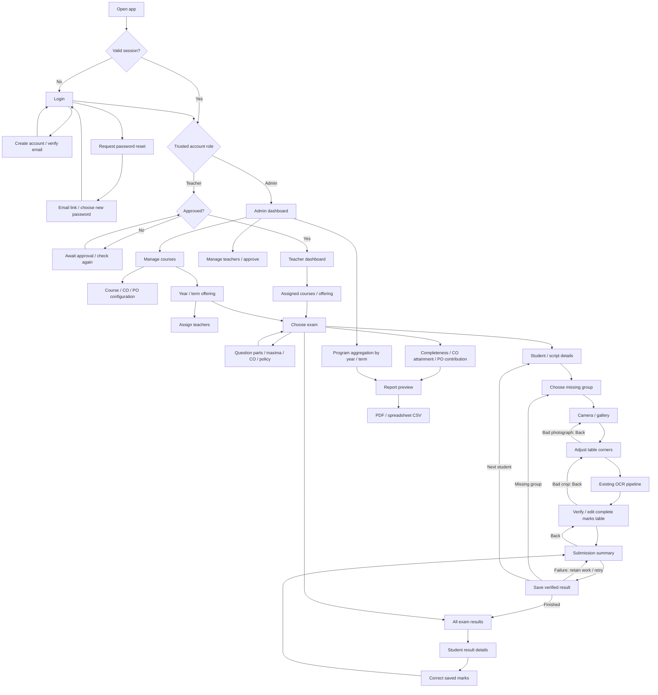

# OBELens X workflow and extension points

The existing Android OpenCV/ONNX scanner and desktop/web Python OCR service remain
in place. Model training and recognition algorithms are unchanged. The application
now surrounds scanning with account permissions, course administration, exam
configuration, persistent results, corrections, attainment and report export.

## Enable the workflow

1. Apply the existing results migration, then
   [`20261024164156_academic_workflow.sql`](../supabase/migrations/20261024164156_academic_workflow.sql)
   to the intended Supabase project. The new migration is additive: existing
   results keep `exam_id = null` and appear under **Previous unassigned results**.
   Do not reapply the original migration to a database where it already ran.
2. Assign the first administrator using a trusted Supabase administrator account:
   set that Auth user's **app metadata** to include `"role": "admin"`. Preserve
   other app metadata. Never use user metadata for roles or put a service key in
   the app. Sign out and sign back in after changing the role so the JWT refreshes.
3. Add `com.obelens.app://auth-callback/` and your deployed web URL to Supabase
   Auth's redirect allowlist. Set the web site URL correctly. The Android intent
   filter and password-recovery screen are included. Email delivery and redirect
   settings still belong to the hosted Supabase project.
4. Run `flutter pub get`, then rebuild the app. The default Supabase project is
   preserved. Another deployment can use `SUPABASE_URL` and
   `SUPABASE_PUBLISHABLE_KEY` through `--dart-define`.
5. Admin: create courses and COs, select PO relationships, add year/term offerings,
   approve registered teachers, and assign teachers to offerings.
6. Teacher: open an assigned offering, create an exam, define the used question
   parts, maxima, CO mappings, required groups and attainment policy, then scan.

Existing accounts are approved when the migration is applied to preserve access.
New accounts await approval after email verification. Students remain result
records; there is no student login role. **Quick scan** preserves the old unassigned
workflow, and those results never enter course attainment implicitly.

This repository change does not apply a migration to the hosted project, assign
a real administrator, or change its email settings. Those deployment steps need
project administrator access.

## Page transitions



The authenticated navigator is destroyed on sign-out or session loss. Back
navigation therefore cannot reopen protected pages. Android's system Back is
forwarded to the active nested route. Returning from verification retains the
existing crop screen and photograph.

## Boundaries that keep changes small

| Concern | Location | Change here when… |
| --- | --- | --- |
| Authentication/session lifecycle | `services/auth_service.dart`, `screens/session_gate.dart` | Changing auth provider, recovery, or session behavior |
| Domain values and validation | `workflow/models.dart` | Changing course, offering, exam or mark rules |
| Data access contract and Supabase adapter | `workflow/repository.dart` | Changing storage, queries or persistence |
| Scanner integration contract | `models/scan_workflow.dart` | Adding context around scanning without changing OCR |
| Recognition/detection ports and default factory | `services/ocr_service.dart` | Selecting another recognizer or model asset |
| Attainment calculation | `workflow/attainment.dart` | Changing eligibility, thresholds, or aggregation mathematics |
| Export port and file generation | `workflow/report_export.dart` | Changing PDF/CSV generation or delivery |
| Feature pages | `workflow/*_pages.dart`, `dashboard.dart`, `report_page.dart` | Changing navigation or presentation |
| Server authorization and integrity | `supabase/migrations/` | Changing persistent schema or database guarantees |

Pages receive a `WorkflowRepository`, OCR service, and exporter where needed.
Tests inject fakes. The scanner receives an optional `ScanWorkflow`; without it,
the original verification/save behavior remains available. Database queries are
kept out of the feature widgets. The attainment calculator is independent of
Flutter, Supabase, and the recognizer. The Python pipeline remains separate from
Android recognition.

For a future compatible ONNX model, bundle its asset and set
`--dart-define=OCR_MODEL_ASSET=assets/ocr_model/<version>.onnx`; the default stays
`assets/ocr_model/inference.onnx`. Include the new asset in `pubspec.yaml`. If the
model's tensor format or decoding changes, implement a new recognizer adapter
behind the existing OCR contract and validate Android compatibility. No UI or
attainment rewrite is needed. This change does not train models, retain student
crops for training, or automatically learn from edits.

## Persistence and calculation rules

- An offering is unique by course, academic year and term. Exams and assignments
  reference that offering; results reference their exam. Course records are
  archived instead of deleted. Archiving blocks new course results and edits
  while preserving reporting access.
- RLS restricts teachers to approved accounts and assigned offerings. Admin
  authorization uses signed app metadata. The save RPC uses invoker security,
  so it remains subject to RLS. The only definer function is the private Auth
  trigger that creates an unapproved profile; clients cannot execute it.
- A result is unique by exam, roll number and group. Saving uses a submission UUID;
  an identical retry returns the saved result. A different scan of an already
  saved group must use **Correct saved marks**, preventing accidental overwrite.
- A full grid is saved atomically. The database checks all 28 cells, integer
  marks, question mappings, configured maxima and archive status, then computes
  the total. Revision checks reject stale corrections and stale exam settings.
  Corrections increment a revision; this is not a full historical audit log.
- No per-cell confirmation is compulsory. Blanks remain `N/A`; the teacher can
  submit after reviewing the table as a whole. The new course flow adds one
  submission summary before persistence.
- Failed saves preserve the current in-memory review and submission ID. This
  survives retry, not application termination. Persistent offline drafts and
  background synchronization are not implemented. Login and saving still need
  Supabase connectivity.
- Required groups must be present. An exam can exclude incomplete scripts or
  block export until they are completed. Optional `N/A` parts are excluded from
  possible marks; required `N/A` parts count zero unless the exam excludes them.
  A student with no possible marks for a CO is ineligible for that CO. There is
  no automatic best-N-of-M optional-question selection.
- For each CO, a student attains it when earned/possible marks meet the score
  threshold. CO attainment is attained students / eligible students. The target
  percentage determines whether the CO target is met. Defaults are 50% and 60%,
  respectively, and are editable per exam; confirm institutional policy.
- Checkbox links carry no implicit weights. Course PO contribution is the equal
  mean of eligible linked CO percentages. Program aggregation uses equal exam
  contributions within each course and equal course contributions per PO in the
  selected year/term. The current schema represents one program; separate
  programs would require a program entity and scoped authorization.
- Reports are calculated from current data rather than persisted as authoritative
  snapshots. Before export the app fetches inputs again and rejects a stale
  preview. Reports include policy, denominators and a generation timestamp.
  Results are paginated to avoid Supabase's default row limit truncating reports.
- PDF and UTF-8 CSV are exported through the platform share/download flow on
  Android and web. The CSV opens in spreadsheet applications and neutralizes
  formula-like text. Native Linux file sharing is not supported by `share_plus`;
  use the web build on Linux. The bundled FreeSans font includes its license.

## Verification

```sh
flutter analyze
flutter test
flutter build web --release --no-pub --pwa-strategy=none
flutter build apk --debug --no-pub
bash scripts/test_workflow_db.sh  # Requires PostgreSQL server/client tools
```

`test/attainment_test.dart` covers policy calculations and exports.
`test/workflow_test.dart` covers restored sessions, role/pending routing, navigation,
save retry, recovery and stale-report protection. The existing OCR, crop, review
and saved-results tests remain regression coverage.

`supabase/tests/workflow.sql` runs after both migrations in a **disposable**
Postgres database with Supabase-compatible `auth.users`, `auth.uid()` and
`auth.jwt()`. It wraps fixtures in a transaction and rolls them back. It covers
role spoofing, assignment isolation, approval, idempotency, duplicate groups,
maxima, missing mappings, revisions and archives. Local database checks do not
replace testing hosted Auth email links, live RLS settings, device camera/OCR,
and native share sheets before release.

The database test script creates its own temporary cluster with a private Unix
socket, runs the migrations and tests, and removes that cluster on exit. It uses
the local Auth stub in `supabase/tests/auth_stub.sql`, never the hosted project.
Hosted Supabase advisors were not run; the tests include checks for RLS on public
tables, anonymous result access and exposed definer functions.
