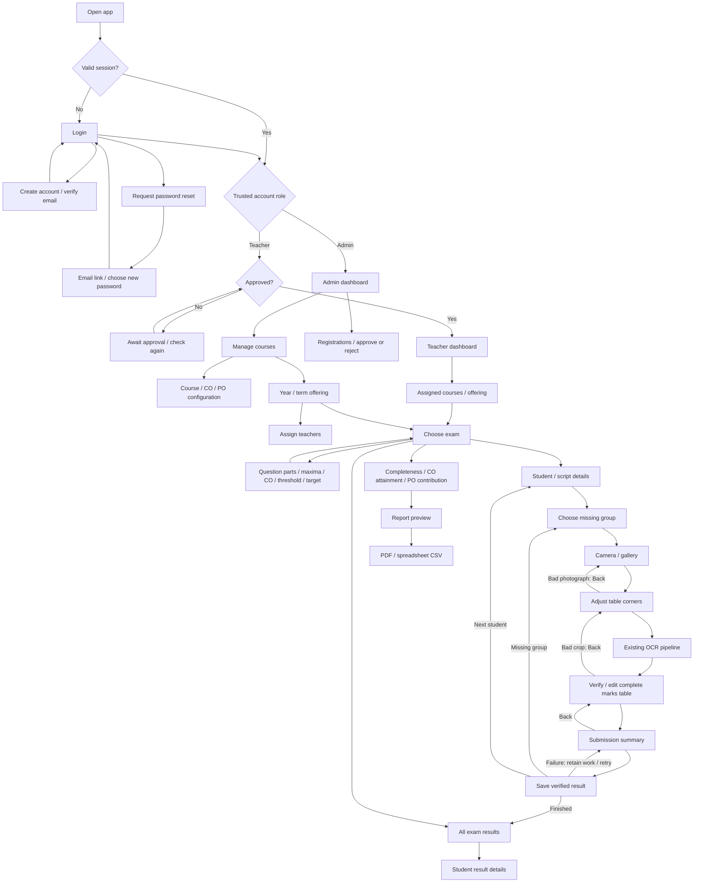

# OBE-Lens workflow and extension points

The existing Android OpenCV/ONNX scanner and desktop/web Python OCR service remain
in place. OCR uses supplied local models for inference only. The application
now surrounds scanning with account permissions, course administration, exam
configuration, persistent results, corrections, attainment and report export.

## Enable the workflow

1. Apply the existing results migration, then
   [`20261024164156_academic_workflow.sql`](../supabase/migrations/20261024164156_academic_workflow.sql)
   and [`20261103140523_allow_admin_course_delete.sql`](../supabase/migrations/20261103140523_allow_admin_course_delete.sql)
   and [`20261103174106_add_fixed_course_outcomes.sql`](../supabase/migrations/20261103174106_add_fixed_course_outcomes.sql)
   and [`20261103174528_remove_attainment_exclusion_options.sql`](../supabase/migrations/20261103174528_remove_attainment_exclusion_options.sql)
   and [`20261104000440_limit_teacher_course_visibility.sql`](../supabase/migrations/20261104000440_limit_teacher_course_visibility.sql)
   and [`20261110120000_limit_course_outcomes_and_disable_result_edits.sql`](../supabase/migrations/20261110120000_limit_course_outcomes_and_disable_result_edits.sql)
   and [`20261120120000_registration_status.sql`](../supabase/migrations/20261120120000_registration_status.sql)
   and [`20261120130000_repair_registration_review_access.sql`](../supabase/migrations/20261120130000_repair_registration_review_access.sql)
   to the intended Supabase project. The migrations are additive: existing
   results keep `exam_id = null` and remain separate from course results.
   The last migration requires existing exam mappings to use CO1–CO4; update
   mappings that use other outcomes before applying it. Do not reapply the
   original migration to a database where it already ran.
2. Create the first administrator using a trusted Supabase administrator account:
   create the account in Supabase Auth, then run
   [`supabase/promote_admin.sql`](../supabase/promote_admin.sql) in the SQL Editor
   after replacing its email placeholder. It updates Auth app metadata while
   preserving other app metadata. The user signs in through the regular app login
   with that account's email and password. Sign out and back in after promotion so
   the JWT refreshes. Never use user metadata for roles or put a service key in
   the app.
3. Add `com.obelens.app://auth-callback/` and your deployed web URL to Supabase
   Auth's redirect allowlist. Set the web site URL correctly. The Android intent
   filter and password-recovery screen are included. Email delivery and redirect
   settings still belong to the hosted Supabase project.
4. Run `flutter pub get`, then rebuild the app. The default Supabase project is
   preserved. Another deployment can use `SUPABASE_URL` and
   `SUPABASE_PUBLISHABLE_KEY` through `--dart-define`.
5. Admin: open **Registrations** to approve or reject new accounts, then create courses
   and COs, select PO relationships, add year/term offerings, and assign approved teachers.
6. Teacher: open an assigned offering, create an exam, define the used question
   parts, maxima, CO mappings, required groups, score threshold and CO target, then scan.

Existing accounts are approved when the migration is applied to preserve access.
New accounts await approval after email verification. Students remain result
records; there is no student login role. **Quick scan** preserves the old unassigned
workflow, and those results never enter course attainment implicitly.

This repository change does not apply a migration to the hosted project, assign
a real administrator, or change its email settings. Those deployment steps need
project administrator access.

## Page transitions



The authenticated navigator is destroyed on sign-out or session loss. Back
navigation therefore cannot reopen protected pages. Android's system Back is
forwarded to the active nested route. Returning from verification retains the
existing crop screen and photograph.

## Boundaries that keep changes small

| Concern                                         | Location                                                      | Change here when…                                            |
| ----------------------------------------------- | ------------------------------------------------------------- | ------------------------------------------------------------ |
| Authentication/session lifecycle                | `services/auth_service.dart`, `screens/session_gate.dart`     | Changing auth provider, recovery, or session behavior        |
| Domain values and validation                    | `workflow/models.dart`                                        | Changing course, offering, exam or mark rules                |
| Data access contract and Supabase adapter       | `workflow/repository.dart`                                    | Changing storage, queries or persistence                     |
| Scanner integration contract                    | `models/scan_workflow.dart`                                   | Adding context around scanning without changing OCR          |
| Recognition/detection ports and default factory | `services/ocr_service.dart`                                   | Selecting another recognizer or model asset                  |
| Attainment calculation                          | `workflow/attainment.dart`                                    | Changing eligibility, thresholds, or aggregation mathematics |
| Export port and file generation                 | `workflow/report_export.dart`                                 | Changing PDF/CSV generation or delivery                      |
| Feature pages                                   | `workflow/*_pages.dart`, `dashboard.dart`, `report_page.dart` | Changing navigation or presentation                          |
| Server authorization and integrity              | `supabase/migrations/`                                        | Changing persistent schema or database guarantees            |

Pages receive a `WorkflowRepository`, OCR service, and exporter where needed.
Tests inject fakes. The scanner receives an optional `ScanWorkflow`; without it,
the original verification/save behavior remains available. Database queries are
kept out of the feature widgets. The attainment calculator is independent of
Flutter, Supabase, and the recognizer. The Python pipeline remains separate from
Android recognition.

For a future compatible ONNX model, bundle its asset and set
`--dart-define=OCR_MODEL_ASSET=assets/ocr_model/<version>.onnx`; the default stays
`assets/ocr_model/inference.onnx`. Include the new asset in `pubspec.yaml`. If the
model's tensor format or decoding changes, implement a new recognizer adapter
behind the existing OCR contract and validate Android compatibility. No UI or
attainment rewrite is needed. Desktop/web recognition loads a compatible local
PaddleOCR inference model from `obelens-ocr/models/recognition/`, or a directory
passed with `python -m ocr.server --model-dir /path/to/model`. Model weights are
never downloaded automatically. Teacher corrections update results only.

## Persistence and calculation rules

- An offering is unique by course, academic year and term. Exams and assignments
  reference that offering; results reference their exam. Course records are
  archived instead of deleted. Archiving blocks new course results and edits
  while preserving reporting access.
- RLS restricts teachers to approved accounts and assigned offerings. Teachers
  can read only courses with an offering assigned to their account. Admin
  authorization uses signed app metadata. The save RPC uses invoker security,
  so it remains subject to RLS. The only definer function is the private Auth
  trigger that creates an unapproved profile; clients cannot execute it.
- A result is unique by exam, roll number and group. Saving uses a submission UUID;
  an identical retry returns the saved result. Saved results are read-only, and
  a different scan cannot overwrite an existing group.
- A full grid is saved atomically. The database checks all 28 cells, integer
  marks, question mappings, configured maxima and archive status, then computes
  the total. The exam revision check rejects saves made against stale exam
  settings.
- No per-cell confirmation is compulsory. Blanks remain `N/A`; the teacher can
  submit after reviewing the table as a whole. The new course flow adds one
  submission summary before persistence.
- Failed saves preserve the current in-memory review and submission ID. This
  survives retry, not application termination. Persistent offline drafts and
  background synchronization are not implemented. Login and saving still need
  Supabase connectivity.
- Incomplete scripts missing a required group are always excluded from attainment.
  `N/A` marks count as zero against the configured maximum. A question part with
  maximum zero is not mapped or included in attainment. A student with no
  possible marks for a CO is ineligible for that CO.
- For each CO, a student receives 1 when earned/possible marks meet the score
  threshold, otherwise 0. CO attainment is attained students / eligible students.
  The default student threshold is 50%, editable per exam. The editable level
  cutoffs default to L0: 0–55%, L1: >55–65%, L2: >65–75%, L3: >75–85%,
  and L4: >85%. Unassessed COs and excluded scripts display N/A.
- Checkbox links carry no implicit weights. Course PO contribution is the equal
  mean of eligible linked CO percentages. Program aggregation uses equal exam
  contributions within each course and equal course contributions per PO in the
  selected year/term. The current schema represents one program; separate
  programs would require a program entity and scoped authorization.
- Reports are calculated from current data rather than persisted as authoritative
  snapshots. Before export the app fetches inputs again and rejects a stale
  preview. Reports include thresholds, denominators and a generation timestamp.
  Results are paginated to avoid Supabase's default row limit truncating reports.
- All results shows one row per student with Roll and mapped question-part
  columns, scoped to the selected course and exam. Selecting a roll opens its
  details. The attainment worksheet shows Roll no and CO1–CO4, followed by CO
  counts/percentages/levels and numerically sorted PO contributions.
- Excel (.xls) is the only report export format. Attainment exports put Report
  details, Student CO attainment, CO attainment, and PO contributions on separate
  tabs in one workbook. Program exports separate details, PO contributions, and
  course breakdown. Linux and Windows use a Save As dialog; Android uses its
  share sheet. Workbook cells preserve leading zeroes and store formula-like
  text literally.

## Verification

```sh
flutter analyze
flutter test
flutter build web --release --no-pub --pwa-strategy=none
flutter build apk --debug --no-pub
bash scripts/test_workflow_db.sh  # Requires PostgreSQL server/client tools
```

To rebuild the latest native releases from the same source:

```sh
flutter pub get
flutter build apk --release --no-pub
flutter build linux --release --no-pub     # Run on Linux
flutter build windows --release --no-pub   # Run on Windows with Visual Studio C++ tools
```

The Android APK is `build/app/outputs/flutter-apk/app-release.apk`. Distribute the
complete `build/linux/x64/release/bundle/` directory for Linux and the complete
`build/windows/x64/runner/Release/` directory for Windows, including their DLLs,
libraries and data. Android release builds currently use the project's existing
debug signing configuration; these are local installation builds, not store releases.

The CI workflow builds all three platforms from the same tested commit and
uploads separate artifacts named with that commit SHA. Windows builds run on
Windows runners. Trigger CI by pushing to main, opening a PR to main, or using
the workflow's manual Run workflow action after the changes are committed and
pushed. A source update does not update an already installed app; install the
new APK or replace the complete desktop bundle.

`test/attainment_test.dart` covers policy calculations and exports.
`test/workflow_test.dart` covers restored sessions, role/pending routing, navigation,
save retry, recovery and stale-report protection. The existing OCR, crop, review
and saved-results tests remain regression coverage.

`supabase/tests/workflow.sql` runs after all migrations in a **disposable**
Postgres database with Supabase-compatible `auth.users`, `auth.uid()` and
`auth.jwt()`. It wraps fixtures in a transaction and rolls them back. It covers
role spoofing, assignment isolation, approval, idempotency, duplicate groups,
maxima, missing mappings, revisions and archives. Local database checks do not
replace testing hosted Auth email links, live RLS settings, device camera/OCR,
and native share sheets before release.

The database test script creates its own temporary cluster with a private Unix
socket, runs the migrations and tests, and removes that cluster on exit. It uses
the local Auth stub in `supabase/tests/auth_stub.sql`, never the hosted project.
Hosted Supabase advisors were not run; the tests include checks for RLS on public
tables, anonymous result access and exposed definer functions.

## Desktop password-reset links

After placing the complete Linux bundle or Windows release folder in its final
location, register its executable for the current OS user:

```sh
python3 scripts/register_desktop_links.py /absolute/path/to/obelens
```

On Windows, use `py scripts/register_desktop_links.py "C:\path\to\obelens.exe"`.
Python is needed only to run this setup script. Rerun it if the app is moved.
The script registers `com.obelens.app` using a Linux desktop entry or the Windows
current-user registry; administrator access is not required.
Allow `com.obelens.app://auth-callback/` in Supabase Auth redirect URLs.
Test a real password-reset email both with the app closed and already running.
Linux and Windows Excel exports show a Save As dialog.

